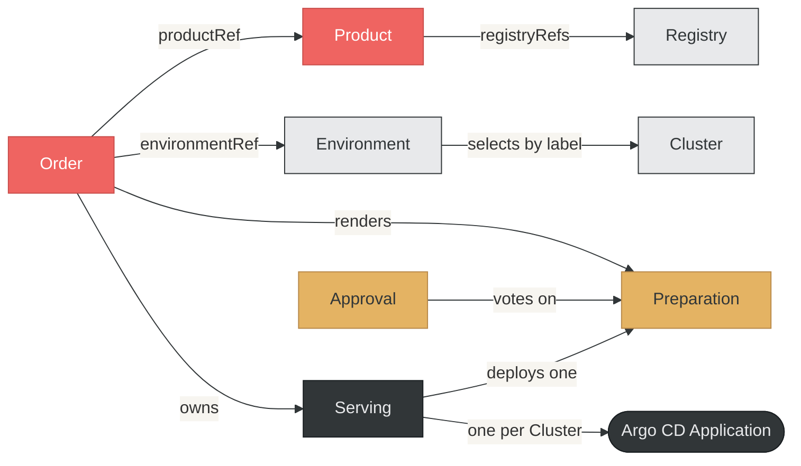
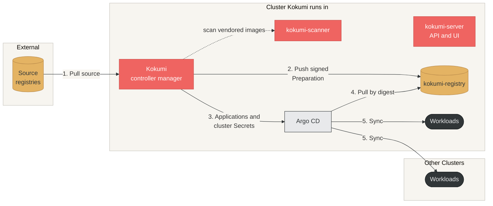

## Three separate concerns

Kokumi draws a hard line between three concerns that most delivery systems
conflate:

1. **Intent**: what _should_ be built, and how. A Product and its Orders.
2. **Artifact**: what _was_ built, exactly. A Preparation.
3. **Activation**: what _runs_. A Serving.

Because the artifact layer is immutable, Kokumi keeps a complete, auditable
history of every version it produced, and promotes or rolls back by moving a
pointer.

## Principles

### Immutable artifacts

A Preparation is an OCI artifact identified by its SHA-256 digest. Once it is
`Ready`, it never changes.

- Re-fetch the artifact by digest to see exactly what ran at any point in
  time.
- Every cluster runs one digest, so what runs where is never ambiguous.
- Every artifact and every record about it is signed with the
  [Kitchen key](../operator-guide/signing/), so anyone can verify it offline
  with stock `cosign`, independently of the cluster.

### Rendering is separate from deployment

```
Render                      Promote                    Deploy
Order ──▶ Preparation ─────────────────────────▶ Serving ──▶ Argo CD Applications
           (immutable)    (human or automatic)      (active pointer)
```

Because the rendered artifact exists before anything deploys it, you can
preview and diff it in the UI, require [approvals](../user-guide/approvals/)
from groups of reviewers, hold it until
[earlier stages](../user-guide/promotion-pipelines/) ran it healthily, or
promote it by hand.

### Rollback without re-rendering

Rolling back means promoting an earlier Preparation. Its artifact is still in
the registry, so the exact state that ran before is restored: no re-render, no
drift.

### Air-gapped by design

Every input is an OCI artifact: the source, the container images, and the
vulnerability database. All of them can be mirrored in advance, so the
pipeline from pull to render to push needs no outbound internet access.

### GitOps, not a replacement

Kokumi never applies manifests and owns no sync loop. Each Serving creates an
Argo CD `Application` per cluster, pinned to the Preparation's digest, and
Argo CD deploys it. Kokumi feeds your existing GitOps workflow rather than
replacing it.

## Resources



| Kind | What it is | Written by |
|---|---|---|
| **Product** | An application: its source, how it renders, base values and patches, its images, and what Orders may change | You |
| **Order** | One variant of a Product, such as one environment: what differs, where it deploys, and how it is promoted | You |
| **Preparation** | One immutable rendered artifact of an Order | Kokumi |
| **Serving** | Which Preparation of an Order is promoted and deployed; one per Order | Kokumi, and **Promote** |
| **Approval** | One reviewer's vote on a Preparation | The server, when someone votes |
| **Environment** | Where Orders deploy: Clusters selected by label, the Argo CD project, and the Environments that come first | Platform team |
| **Cluster** | One cluster Kokumi deploys to, and how to reach it | Platform team |
| **Registry** | A connection to an OCI registry: URL prefix, credentials, TLS settings and scheme | You or the platform team |
| **Repository** | A catalog entry: an OCI repository to browse and create Products from | You or the platform team |
| **Kitchen** | The settings of the installation, one named `default` | Cluster admin |

Every kind is namespaced, and references stay within one namespace: an Order,
its Product, Environment and Registries, and the Environment's Clusters live
together. The Kitchen lives in Kokumi's own namespace. `kubectl get kokumi -A`
lists every Kokumi object.

## From a change to a running cluster

```
Product ──resolves tag to digest, verifies it──▶ status.source
   │
Order ──merges its intent over the Product's──▶ render: pull ─▶ Helm ─▶ patches ─▶ edits ─▶ images ─▶ push
                                                                                                 │
Preparation ◀── signs it, attaches SLSA provenance ◀──────────────────────────────────────────────┘
   │
Serving ──▶ gates: upstream stages ─▶ checks ─▶ approvals ─▶ evidence in the registry
   │
   ├──▶ signed promotion record
   └──▶ Argo CD Application per Cluster ──▶ Argo CD syncs ──▶ healthy ──▶ signed deployment record
```

1. **The Product resolves its source.** It resolves the source tag to a
   digest once, verifies its signature when required, and publishes it in
   `status.source`. Every Order renders that digest, even if the tag moves
   upstream. See [Products and Orders](../user-guide/products-and-orders/)
   and [Source Verification](../user-guide/source-verification/).
2. **The Order renders.** Kokumi merges the Order over its Product into the
   _intent_. Whenever the intent changes, it renders a new Preparation and
   pushes it to the Order's destination, by default the bundled registry. See
   [What renders a new Preparation](../user-guide/products-and-orders/#what-renders-a-new-preparation).
3. **The Preparation is signed.** Kokumi signs the artifact and attaches a
   SLSA provenance. Only then is the Preparation `Ready`. See
   [Artifacts in the Registry](../user-guide/artifacts/).
4. **The Serving promotes.** Under `Automatic` it takes the newest `Ready`
   Preparation; under `Manual` the one you promote. The Preparation passes
   its gates in order, and the Serving records the promotion. See
   [Promotion and Rollback](../user-guide/promotion/).
5. **Argo CD deploys.** The Serving writes one Application per Cluster of the
   Order's Environment, pinned to the digest, and records the deployment once
   every cluster runs it healthily. See
   [Deploy to Several Clusters](../user-guide/environments/).

The controllers are level-triggered and idempotent: they act on the state
they observe, and the same input produces the same output. Preparations and
the Serving are owned by their Order.

## Trust

A Preparation's evidence lives in the registry, next to the artifact, as
Sigstore bundles attached through the OCI referrers API: its signature, its
provenance, the sealed approvals, and a record of every promotion and healthy
deployment. Anyone who can pull the artifact can verify the whole chain with
the Kitchen's public key.

- **Kokumi verifies before it deploys.** Argo CD verifies no OCI signatures,
  so before each promotion the Serving checks the evidence in the registry,
  not the Preparation's status: a trusted signature, a provenance that names
  this Order, and the approvals. Argo CD then pulls exactly the digest that
  was verified.
- **Only Kokumi writes what decides a promotion.** Admission policies let
  only the controller write the status of Kokumi's resources and only the
  server create Approvals, and they guard the signing key. See
  [Authorization](../operator-guide/authorization/).
- **The intent is not secret.** It is stored inside the artifact, so anyone
  who can pull a Preparation can read its values and patches.

## Components



| Component | What it does |
|---|---|
| `kokumi-controller-manager` | Reconciles every kind: resolves sources, renders, signs, checks the gates, and writes Argo CD Applications and the cluster Secrets of the Clusters they deploy to. |
| `kokumi-server` | Serves the API and the UI. It acts as the ServiceAccounts a user maps to; see [Authorization](../operator-guide/authorization/). |
| `kokumi-registry` | The bundled OCI registry, backed by a PersistentVolumeClaim. It is the default destination of Preparations and vendored copies. Argo CD pulls from it; other clusters need a registry they can reach for vendored images. |
| `kokumi-scanner` | Runs Trivy for the controller when the Kitchen enables [scanning](../operator-guide/scanning/). Only the controller can reach it. |
| Argo CD | Runs in the namespace `argocd` of the cluster Kokumi runs in, and deploys to every Cluster. |

All Kokumi components run in the namespace `kokumi`; the signing key lives in
`kokumi-signing`. See [Installation](../installation/).
