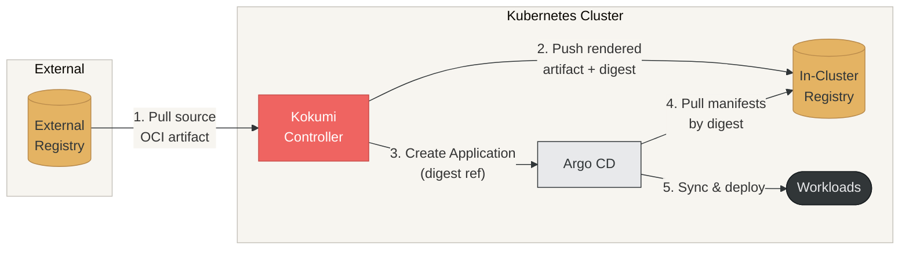

## Core philosophy

Kokumi draws a hard line between three concerns that most delivery systems conflate:

1. **Intent** — what _should_ be built and how (a Product and its Orders)
2. **Artifact** — what _was_ built, exactly (the Preparation)
3. **Activation** — what is _currently running_ (the Serving)

By keeping these separate and immutable at the artifact layer, Kokumi gives
you a complete, auditable history of every version ever produced and the
ability to promote or roll back with a single field change.

## Key advantages

### Immutability at the artifact layer

A Preparation is not a live snapshot. It is an OCI artifact identified by a
SHA-256 digest. Once a Preparation reaches `Ready`, it never changes.

- Reproduce exactly what was running at any point in time by re-fetching the
  artifact by digest.
- Drift is unambiguous. Compare the deployed digest to the desired digest.
  Any difference is a concrete, actionable signal.
- Every artifact and attestation is signed with the Kitchen key, so anyone can
  verify and audit it offline with stock `cosign`, independently of the cluster.

### Separation of rendering from deployment

Kokumi keeps rendering and deployment as two distinct, independently
controllable steps:

```
Render                      Promote                    Deploy
Order ──▶ Preparation ─────────────────────────▶ Serving ──▶ Argo CD Application
           (immutable)    (human or auto)           (active pointer)
```

Because the rendered artifact is stored independently:

- **Approval gates** — set `spec.promotion.approvals` to require votes from
  named reviewers before a Preparation can be served, in both Manual and
  Automatic mode. See [Approvals](#approvals).
- **Manual promotion** — set `spec.promotion.mode: Manual` to hold the
  Serving until a human explicitly promotes the Preparation.
- **Pre-flight validation** — inspect the full rendered manifest in the UI
  before it touches any cluster.

### Rollback without re-rendering

Rolling back means promoting any previous Preparation. The artifact already
exists in the in-cluster registry, so the exact state that previously ran is
restored instantly: No re-render, no drift.

### Air-gap friendly by design

The entire pipeline — OCI pull → render → push to in-cluster registry — has no
requirement for outbound internet access. All external dependencies are OCI
artifacts that can be mirrored in advance, making Kokumi suitable for
restricted and disconnected environments. That includes the vulnerability
database scanning reads.

### GitOps integration, not replacement

Kokumi does not apply manifests directly and does not own a sync loop. Each
Serving creates or updates an Argo CD `Application` pointing at the
Preparation's OCI artifact by digest. Kokumi feeds your existing GitOps
workflow rather than replacing it.

## Dependencies

Kokumi requires **Argo CD** (≥ 3.3) installed in the `argocd` namespace.
When a Serving is created or updated, the Serving controller creates or updates
an Argo CD `Application` resource that points to the immutable OCI artifact of
the selected Preparation. Argo CD then syncs that artifact into the cluster.

> **Kokumi does not apply manifests directly.** All runtime deployment is
> delegated to Argo CD. Without Argo CD, no workloads are deployed; without
> its CRDs, Servings report `ArgoCDNotInstalled`.

## Resource model

```
Product ◀──variant of── Order  (one Order per environment or rollout)
                          │
Order ──renders──▶ Preparation (immutable, versioned OCI artifact)
                         ▲
Serving ──selects────────┘  (mutable pointer to one Preparation)
   │
   └──creates/updates──▶ Argo CD Application, one per cluster of the Order's Environment
                              │
                              └──syncs──▶ Cluster workloads

Recipe ──provides render profile──▶ Order  (for example Helm options)
```

### Product

A Product is the complete definition of an application. It pins the source OCI
reference and version, sets the render type and options, and holds the base
Helm values and patches. A Product is never rendered or deployed on its own;
its Orders are.

```yaml
apiVersion: delivery.kokumi.dev/v1alpha1
kind: Product
metadata:
  name: podinfo
  namespace: shop
spec:
  source:
    url: oci://ghcr.io/stefanprodan/charts/podinfo
    version: "6.14.1"
  render:
    helm:
      values:
        replicaCount: 1
        ui:
          color: "#EF6461"
  patches:
    - target:
        kind: Deployment
        name: podinfo
      set:
        .spec.template.spec.terminationGracePeriodSeconds: "30"
```

The Product controller resolves the source tag to a digest, verifies its
signature when required (see [Source verification](#source-verification)), and
publishes it in `status.source` (URL, version, digest and the verified
signer). Orders pull the source by that digest, only once the Product is
`Ready` for its current generation. Every variant of a Product therefore
renders the same artifact, even if the upstream tag is moved. The Product
resolves the tag again only when its source or vendor configuration changes;
the new digest renders a new Preparation for every Order.

#### Registries

A Product and an Order list the Registries they connect through in
`spec.registryRefs`. A Registry is a URL prefix with its credentials, TLS
settings and scheme. Each location uses the Registries of its owner, the one
with the longest matching URL winning: the Product owns its source, the
images and their mirrors, and its vendor location; the Order owns only its
destination. Without a matching Registry, Kokumi accesses a location
anonymously over HTTPS, and the bundled registry over HTTP. Both objects
report every location they need, and who accesses it, in
`status.registryAccess`, and refuse to copy content read with credentials to
a location written without them (`CredentialsRequired`). Registries are not
part of the intent: a new token or Secret renders nothing. See
[Registries and Repositories](user-guide/registries/).

A Product cannot be deleted while Orders reference it. The
`delivery.kokumi.dev/product-protection` finalizer keeps it, like
`kubernetes.io/pvc-protection` keeps a claimed volume, and its `Ready`
condition reports `InUse` with the names of the remaining Orders. The UI shows
the Product as `Deleting` and offers no new Orders for it; Orders of a Product
being deleted wait with reason `ProductDeleting`.

#### Restricting what Orders may change

`spec.overrides` decides what the Orders of a Product may change, separately
for Helm values and for patches (which cover UI edits too). Each has a
`policy`, which the API server defaults to `None` and stores with the
Product:

```yaml
spec:
  overrides:
    values:
      policy: Listed
      paths:
        - replicaCount
        - ui.message
    patches:
      policy: Listed
      targets:
        - target:
            kind: Deployment
            name: podinfo
          paths:
            - .spec.replicas
```

| `policy` | Orders may set |
|---|---|
| `None` (default) | nothing |
| `Listed` | only the listed Helm value paths (leaf paths, dot-separated), or the listed patch targets and paths |
| `All` | any value, or any patch and edit |

`paths` and `targets` are required with `Listed` and rejected otherwise. A
target without a namespace matches the resource in any namespace; when several
targets match, the paths of all of them are allowed. An Order that sets
anything else fails with a `ProcessingFailed` condition naming the offending
value or patch.

#### Source verification

A Product can require its source to carry a trusted signature before any of
its Orders renders it. `spec.source.verify` has the shape of Flux's
`OCIRepository.spec.verify` and is verified with the cosign library, which
reads Sigstore bundles as well as the legacy `sha256-<hex>.sig` signatures
many upstream artifacts still carry:

```yaml
spec:
  source:
    url: oci://ghcr.io/stefanprodan/charts/podinfo
    version: "6.10.2"
    verify:
      provider: cosign                 # the only provider; the default
      secretRef:                       # every key ending in .pub is tried
        name: podinfo-keys
      # or keyless, against the identity that signed the release:
      # matchOIDCIdentity:             # RE2 regular expressions, not anchored
      # - issuer: ^https://token\.actions\.githubusercontent\.com$
      #   subject: ^https://github\.com/stefanprodan/podinfo/\.github/workflows/release\.yml@refs/tags/.*$
      # trustedRootSecretRef:          # key trusted_root.json; required air-gapped
      #   name: sigstore-root
```

- Key-based signatures verify offline, without a transparency log.
- Keyless signatures verify against the Sigstore trusted root in
  `trustedRootSecretRef`, or against the Sigstore public-good instance through
  TUF when it is unset, which needs network access.
- A source without `verify` that carries a signature by a key the Kitchen
  trusts verifies too: releases of this Kokumi installation or, once its key
  is trusted, of another one.
- Every signature in the graph of the source is checked with the same policy,
  including the publisher's signatures on attachments such as an SBOM, and
  recorded in `status.source.signatures`. Only a signature on the source itself
  decides; the others are evidence the Artifact tab shows.
- The result is the `SourceVerified` condition, with reason `Succeeded`,
  `VerificationError` or `VerificationRequired`, and `status.source.verified`,
  which names the key ID or the keyless issuer and subject. The condition is
  absent when nothing was verified and nothing had to be.
- A Product whose source does not verify is not `Ready`, publishes no new
  source, and none of its Orders render. It is verified again every few
  minutes and whenever the trusted keys change.
- The Kitchen's `spec.signing.requireSourceVerification` makes verification
  mandatory for every Product.

Every Order copies the verified signer into its artifact's config blob as
`source.verified`, and the signed provenance repeats it, so the registry
records who published each rendered input.

#### Vendoring

A Product can **vendor** its source: copy the artifact (Helm chart or manifest
bundle) unchanged to another OCI registry, for example to prepare an
air-gapped installation. The source is copied by the digest that verified,
together with its referrers, so the copy keeps the publisher's signatures and
attestations and still verifies against the publisher's key. Orders then
render from the vendored copy:

```yaml
spec:
  source:
    url: oci://ghcr.io/kokumi-dev/testdata/external-secrets
    version: "0.1.0"
  vendor:
    url: oci://harbor.corp/mirror/external-secrets   # vendor: {} copies to <namespace>/vendor/<name> in the in-cluster registry
  registryRefs:
  - name: harbor-mirror        # its url covers the vendor location
```

The copy carries the referrers of the source, the OCI 1.1 way of attaching
signatures, SBOMs and attestations. Signatures that cosign stored under
legacy `sha256-<digest>.sig` tags are not referrers and are not copied. The
**Artifact** tab of a Product draws the source and the vendored copy side by
side, so you can see that both have the same digest and what came along.

The Product's Registries authenticate both the upstream source and the copy.
The vendored reference is published in `status.source`, so Orders need no
knowledge of the vendoring setup, and they pull it through the Product's
Registries too.

#### Images

`spec.images` decides what happens to the container images the rendered
manifests reference. Every render finds them, following kustomize's image
transformer, and resolves each to a digest through the Product's Registries
and the Kitchen's mirrors:

```yaml
spec:
  images:
    policy: Pin                # Record (default) | Pin | Vendor
    fieldSpecs:                # custom resource fields that hold an image
    - group: monitoring.coreos.com
      kind: Prometheus
      path: spec/image
  vendor: {}                   # required by Vendor: the images go below it
  registryRefs:                # private image registries and mirrors
  - name: dockerhub
```

- `Record` lists every image by digest in the Preparation and leaves the
  manifests unchanged.
- `Pin` rewrites `repo:tag` to `repo:tag@sha256:…`.
- `Vendor` copies every image, with all platforms and its referrers, into a
  repository of its own below the Product's vendored source,
  `<vendor>/images/<image name>`, tagged with the tag its reference names,
  and rewrites the reference to pull it from there by digest:
  `ghcr.io/stefanprodan/podinfo:6.14.1` becomes
  `<vendor>/images/ghcr.io/stefanprodan/podinfo:6.14.1@sha256:…`. It
  requires `spec.vendor`, and all Orders of the Product share the copies.

Images are resolved once per render. A tag that moves upstream does not render
a new Preparation; promotion and rollback run exactly the digests a
Preparation recorded. Under `Pin` and `Vendor` the digests of the Order's
latest Preparation act as a lock file: a later render keeps the digest of
every reference written the same way and resolves only new or changed ones.
Orders cannot change the image settings. See
[Container Images](user-guide/images/).

#### Vulnerability scanning

When the Kitchen enables scanning, Kokumi scans every vendored image that a
Preparation in use runs, once per Product per digest and again every day.
The `kokumi-scanner` component runs Trivy; the controller manager signs the
SBOM and the vulnerability report and attaches them to the vendored image as
OCI referrers, and records a summary in `status.vulnerabilities` with the
`Scanned` condition. An SBOM that already comes with the image is reused only
when it cannot be forged: one BuildKit wrote into the image index, or one a
trusted key signed. See
[Vulnerability Scanning](user-guide/security-scanning/).

### Recipe

Recipe captures rendering configuration, including options like Helm rendering
behavior and values-related settings.

### Order

An Order is a variant of exactly one Product, for example one environment
such as `podinfo-dev` or `podinfo-prod`. `spec.productRef` names the Product
in the same namespace and cannot be changed after creation. The Order only
declares what differs from its Product:

```yaml
apiVersion: delivery.kokumi.dev/v1alpha1
kind: Order
metadata:
  name: podinfo-prod
  namespace: shop
spec:
  productRef:
    name: podinfo
  values:                # deep-merged over the Product's render.helm.values
    replicaCount: 3
  patches: []            # merged over the Product's patches, per target
  edits: []              # changes made in the UI, applied after patches
  destination:
    url: oci://ghcr.io/shop/podinfo-prod
  registryRefs:          # authenticate the destination only
  - name: ghcr-shop-push
  promotion:
    mode: Manual
    after:               # upstream stages: Orders of the same Product
    - order: podinfo-staging
      soakSeconds: 86400
    approvals:
      requiredApprovals: 2
      allowedGroups:
        - release-approvers
```

- **Values** are deep-merged over the Product's Helm values; the Order wins.
  They are only valid when the Product renders with Helm.
- **Patches** are merged over the Product's patches per target; on the same
  path the Order wins.
- **Edits** are applied after patches. The UI writes them when you edit a
  rendered file.
- **Destination** and **promotion** are per Order: each variant has its own
  Preparation history, Serving, and gates. The Order's `registryRefs`
  authenticate its destination; the Preparation records the Registry it was
  pushed through in `spec.artifact.registryRef`.
- **Upstream stages** (`promotion.after`) order the Orders of a Product into
  a pipeline. See [Promotion pipelines](#promotion-pipelines).
- The **target namespace** is where the workload lands: the Order's
  `targetNamespace`, else its Product's, else the Order's namespace. It is
  part of the intent: Helm renders into it, and Argo CD deploys resources
  without a namespace there, creating the namespace when it is missing. A
  Preparation records it in `spec.targetNamespace` and deploys there wherever
  it is promoted. Changing it renders a new Preparation, and deploying that
  moves the workload: Argo CD deletes it in the old namespace.

Every change to an Order or to its Product (a new source version, other values
or patches) triggers a new reconciliation and, if the intent changed, a new
Preparation. A change to the Product always renders every Order again, also an
Order whose own values or patches hide it, because the intent holds the
[Product revision](#the-product-revision). Promotion stays per Order, so a new
Product version can deploy automatically to `podinfo-dev` while `podinfo-prod`
waits for `podinfo-staging` and for approvals.

While its Product is missing, not `Ready`, or being deleted, an Order reports
`Ready=False` with reason `ProductNotFound`, `ProductNotReady`, or
`ProductDeleting` and waits; the UI shows it as `Waiting`. It continues as
soon as the Product is ready.

### Preparation

Preparations are **created automatically** by Kokumi whenever an Order changes.
You never create them directly.

A Preparation is the _output_ of rendering an Order at a specific point in time.
It contains:

- A reference to the parent Order and the exact source revision used
- An OCI artifact digest (stored in the in-cluster OCI registry)
- An immutable status: once `Ready`, a Preparation never changes

Preparations are **never garbage-collected automatically**. You retain full
history and can promote any old Preparation to active at any time.

#### Linking a Preparation back to its source

Every Preparation records where its base OCI artifact came from, so you can
trace any deployed version back to the exact commit or tag that produced it.
Kokumi reads provenance from the base artifact's OCI annotations and copies
them onto the rendered Preparation artifact and its CR. The primary keys are
`org.opencontainers.image.source`, `org.opencontainers.image.version`, and
`org.opencontainers.image.revision`, with
fallbacks so artifacts that omit one still link correctly:

| Annotation (base artifact) | Fallback | Preparation field | Meaning |
|---|---|---|---|
| `org.opencontainers.image.source` | `org.opencontainers.image.url` | `spec.gitSource.repo` | SCM repository URL of the base artifact's source |
| `org.opencontainers.image.version` | — | `spec.gitSource.tag` | SCM tag of the base artifact's source |
| `org.opencontainers.image.revision` | — | `spec.gitSource.commitHash` | SCM commit SHA of the base artifact's source |

Kokumi also stamps the base artifact's identity onto the rendered artifact so
the chain is verifiable from the artifact alone:

- `org.opencontainers.image.base.name` — the base artifact's OCI reference
- `org.opencontainers.image.base.digest` — the base artifact's digest

#### What a Preparation looks like in the registry

A Preparation artifact explains itself from the registry alone: what was asked
for, what it was built from, what built it, and what came before it.

```
kokumi-registry.kokumi.svc.cluster.local:5000/shop/podinfo-prod
│
├─ sha256:c3…  manifest   artifactType: application/vnd.kokumi.preparation.v1
│   ├─ config  application/vnd.kokumi.preparation.config.v1+json     (intent)
│   ├─ layer   application/vnd.oci.image.layer.v1.tar+gzip           (rendered YAML)
│   └─ annotations
│        org.opencontainers.image.description: "bump replicas to 3"
│        org.opencontainers.image.source / .version / .revision
│        org.opencontainers.image.base.name / .base.digest
│        kokumi.dev/parent: sha256:c1…
│
├─ referrers of sha256:c3…  (Sigstore bundles, application/vnd.dev.sigstore.bundle.v0.3+json)
│   ├─ predicate https://sigstore.dev/cosign/sign/v1              signature
│   ├─ predicate https://slsa.dev/provenance/v1                   SLSA v1 provenance
│   ├─ predicate https://kokumi.dev/attestations/approval/v1      sealed approvals, before promotion
│   ├─ predicate https://kokumi.dev/attestations/promotion/v1     per promotion
│   └─ predicate https://kokumi.dev/attestations/deployment/v1    per healthy deployment
│
└─ tag 6.10.2 → sha256:c3…

kokumi-registry.kokumi.svc.cluster.local:5000/shop/vendor/podinfo/images/ghcr.io/stefanprodan/podinfo
│                                                                          (images.policy: Vendor)
├─ sha256:aa…  image index with its platforms and its upstream referrers
└─ tag 6.10.2 → sha256:aa…
```

- The **referrers** (signature, provenance, approvals, promotion and
  deployment records) are Sigstore bundles,
  artifactType `application/vnd.dev.sigstore.bundle.v0.3+json`, attached
  through the OCI 1.1 referrers API: each names the Preparation's manifest in
  its `subject`. Registries without that API store them through the referrers
  tag schema; tools find them either way.
- The **annotations** of the manifest: `org.opencontainers.image.description`
  (the commit message), `org.opencontainers.image.source`, `.version` and
  `.revision`, `org.opencontainers.image.base.name` and `.base.digest`, and
  `kokumi.dev/parent`.
- The **tag** is the source version. A later Preparation of the same version
  moves it; the digest of this one never changes.
- The **vendored images**, under `images.policy: Vendor`: every image the
  manifests pull, with all its platforms and its referrers, in a repository
  of its own below the Product's vendored source, tagged with the tag its
  reference names. They are not part of the Preparation's graph; the manifests
  reference them by digest, and the config blob and the provenance list them.
  Both are covered by the Preparation's signature, and an image is identified
  by its digest wherever it is copied, so the signed list pins every image the
  Preparation runs.

The **Artifact** tab of a Preparation draws this graph live from the
registry, including anything else attached to the artifact, and verifies every
Sigstore bundle in it. See [Artifacts in the registry](user-guide/artifacts/).

The **config blob** is the authoritative record. The `kokumi.dev/*` and
description annotations repeat parts of it so tools can read them without
fetching a blob.

```json
{
  "schemaVersion": 1,
  "order": { "namespace": "shop", "name": "podinfo-prod", "uid": "6f0c…" },
  "configHash": "sha256:9b1d…",
  "commitMessage": "bump replicas to 3",
  "createdTime": "2026-10-12T09:14:03Z",
  "parent": "sha256:c1…",
  "source": {
    "oci": "oci://kokumi-registry.kokumi.svc.cluster.local:5000/shop/vendor/podinfo", "version": "6.10.2", "digest": "sha256:aa…",
    "verified": { "provider": "cosign", "issuer": "https://token.actions.githubusercontent.com", "subject": "https://github.com/…" }
  },
  "destination": { "oci": "oci://kokumi-registry.kokumi.svc.cluster.local:5000/shop/podinfo-prod" },
  "product": { "namespace": "shop", "name": "podinfo", "configHash": "sha256:77e0…" },
  "renderer": { "type": "Helm", "version": "v4.3.0", "builder": "ghcr.io/kokumi-dev/kokumi@sha256:bb…" },
  "intent": { "source": {}, "productRevision": "sha256:5e1f…", "destination": "", "targetNamespace": "shop", "render": {}, "patches": [], "edits": [], "images": {}, "promotion": {} },
  "images": [
    {
      "ref": "ghcr.io/stefanprodan/podinfo:6.10.2", "name": "ghcr.io/stefanprodan/podinfo",
      "digest": "sha256:aa…", "mediaType": "application/vnd.oci.image.index.v1+json",
      "vendored": "kokumi-registry.kokumi.svc.cluster.local:5000/shop/vendor/podinfo/images/ghcr.io/stefanprodan/podinfo:6.10.2@sha256:aa…"
    }
  ]
}
```

`createdTime` equals the manifest's `org.opencontainers.image.created`
annotation.

`images` lists every container image the manifests reference: the reference
as written, its normalized name, the digest and media type it resolved to,
the vendored reference under `Vendor`, and the reason for an image that could
not be resolved. `Preparation.spec.images` repeats the list without the
reasons.

`product.configHash` is the Product's own hash at render time: the hash of the
source and vendor configuration its source was resolved from, not the hash of
the intent.

#### Intent and the config hash

The **intent** is the merged, effective configuration that determines the
artifact. `configHash` is the SHA-256 of its canonical JSON: compact, object
keys sorted at every level, numbers kept as written, and no HTML escaping. The
config blob stores the `intent` member with exactly these bytes, so equal
hashes mean equal intent, and anyone can recompute the hash: it is the SHA-256
of the `intent` value as it stands in the blob.

- The gates of `spec.promotion` (approvals, upstream stages, checks) are part
  of the intent: changing one creates a new Preparation that needs fresh
  approvals. Switching the promotion mode does not. The upstream stages are
  sorted by Order.
- Changing a Product renders a new Preparation for every Order of that
  Product, because the intent holds the [Product
  revision](#the-product-revision), also when an Order's own values or
  patches hide the change. The source digest is part of the intent too.
- The image policy and field specs are part of the intent unless they are the
  defaults (`Record`, no field specs), and under `Vendor` so is the location
  the images are copied below. The digests images resolve to are not: they
  are an outcome of the render, so a moved upstream tag renders nothing new.
- The target namespace is part of the intent, always, also when it is the
  Order's own namespace: Helm's output depends on it.
- The Registries a Product or Order connects through, their Secrets, and the
  Kitchen's mirrors are not part of the intent: a new token renders nothing.


The intent is stored inside the artifact, so **anyone who can pull the
artifact can read it**: Argo CD, cluster nodes, and anyone the artifact is
copied to. Do not put secrets into Helm values or patches. Pull access to a
destination repository equals read access to the intent of every Preparation
in it.

Anyone who can push to the repository can push an artifact that looks like a
Preparation. The signature of a Preparation's artifact covers its manifest,
and with it the config blob, the rendered layer and the annotations: trust
intent and lineage read from the registry only once the signature verifies
against the Kitchen key.


#### The Product revision

The **Product revision** links the Preparations that the Orders of a Product
render from one Product change, as GitOps Promoter's dry commit links the
hydrated commits of its environments. It identifies the change; it is never
promoted. Each Order only ever deploys its own Preparations.

It is the SHA-256 of the canonical JSON of the Product's part of the intent:

- the resolved source digest;
- the Product's render config, before an Order's values are merged;
- the Product's patches;
- the image policy and field specs, and under `Vendor` the location the images
  are copied below, which the manifests pull from.

The source URL and version, the overrides and the Registries are left out:
they change no output. The digests images resolve to are left out too, so two
stages run different digests of the same tag when their renders straddle an
upstream tag move; each Preparation's provenance lists its images.

The revision is recorded in the intent (`productRevision`) and in
`Preparation.spec.productRevision`, a selectable field:

```bash
kubectl get preparations -n shop --field-selector spec.productRevision=sha256:5e1f…
```

Upstream stages are matched by it: see [Promotion
pipelines](#promotion-pipelines).

#### Lineage

Lineage is the **render history of one Order in one repository**. Every
Preparation names the one rendered before it as its `parent`, in the config
blob and in the `kokumi.dev/parent` annotation. Walking `parent` backwards
gives the history, including Preparations that were never deployed.

- Nothing is ever written to an older artifact. A Preparation carries no
  pointer to later revisions, so copying one artifact with its referrers
  copies exactly that one revision and its evidence.
- The newest Preparation of an Order is `Order.status.latestArtifactDigest`.
  Without cluster access it is the version tag whose config blob has the
  newest `createdTime`: every Preparation is pushed under its source version,
  so the newest one is always behind a tag.
- A history ends at a Preparation without a `parent`, or at a `parent` that
  does not exist in the repository. The second case is normal after the
  Order's destination changed.

#### Provenance and renderer identity

`spec.renderer` records what rendered a Preparation:

| Field | Meaning |
|---|---|
| `type` | `Helm` or `Manifest` |
| `version` | The Helm library version for `Helm`, the Kokumi version for `Manifest` |
| `builder` | The controller that rendered it, normally its image reference with digest |

The controller determines `builder` once at start-up: the `KOKUMI_BUILDER_ID`
environment variable if set, otherwise the image ID of its own Pod, otherwise
`kokumi@<version>`. It is self-reported.

After the artifact is pushed, the Preparation controller signs it and attaches
a [SLSA v1 provenance](https://slsa.dev/spec/v1.0/provenance) statement, both
as OCI referrers in the format `cosign` v3 writes: a Sigstore bundle holding a
DSSE envelope over an in-toto statement, signed with the
[Kitchen key](operator-guide/signing/). It records both in
`status.attestations` (types `Signature` and `Provenance`) and sets the
`Signed` and `ProvenanceAttached` conditions.

- The signature is the statement `cosign sign` writes (predicate type
  `https://sigstore.dev/cosign/sign/v1`).
- The provenance is built entirely from the config blob. Its `builder.id` is
  `https://kokumi.dev/builders/controller/v1`; `builder.version` names the
  controller image and the rendering engine, and the source is listed by its
  OCI URL, digest and verified signer. Every container image that resolved to
  a digest follows the source in `resolvedDependencies`, with its media type
  and, under `Vendor`, its vendored reference.
- Signing is deterministic (RFC 6979), so a retried push yields the same
  referrer, and an existing referrer with the same statement is reused.

A Preparation becomes `Ready` only once it is `Signed` and `ProvenanceAttached`,
and only a `Ready` Preparation is served, under both promotion modes: promoting
one that is not ready is refused, and the Serving keeps the current
deployment. An artifact whose config blob cannot be read as a Kokumi config is
never signed and never ready.

Anyone can verify a Preparation offline with the stock cosign CLI:

```bash
kubectl -n kokumi get kitchen default -o jsonpath='{.status.signing.publicKey}' > kokumi.pub
cosign verify --key kokumi.pub --insecure-ignore-tlog=true <registry>/shop/podinfo-prod@sha256:c3…
cosign verify-attestation --key kokumi.pub --insecure-ignore-tlog=true --type slsaprovenance1 <registry>/shop/podinfo-prod@sha256:c3…
```

The Artifact tab of a Preparation shows every referrer of the artifact live
from the registry and verifies each against the keys the Kitchen trusts.
Anyone who can push to the repository can attach a referrer, so the view
shows the statement of verified referrers only.

### Serving

A Serving tracks which Preparation is actively deployed. There is exactly one
Serving per Order, named after the Order, and it is **managed automatically**;
you never create one directly. The promotion mode is always read from the
Order's `spec.promotion.mode`:

- **Automatic** — Kokumi creates the Serving and always targets the newest
  `Ready` Preparation of the Order (`status.targetPreparationName`).
- **Manual** — click **Promote** on a Preparation in the Kokumi UI (or set the
  Serving's `spec.preparationName`). Rolling back is promoting an older
  Preparation. A promotion is an intention: a Preparation its gates still
  hold is **queued**, and the Serving deploys it once they pass. See
  [Queued promotions](#queued-promotions).

When a Serving is reconciled, the controller decides whether to promote the
Preparation it converges to, then deploys the promoted one.

1. Resolves the Preparation to serve and its immutable OCI artifact digest.
   It must be `Ready`.
2. Enforces its **upstream stages** (`spec.promotion.after`): each must have
   deployed its own Preparation of the same Product revision healthily for
   its soak time. Otherwise the `UpstreamDeployed` condition explains why. See
   [Promotion pipelines](#promotion-pipelines).
3. Enforces its **promotion checks** (`spec.promotion.checks`). For the
   vulnerability check, every image needs a recent, signed report in the
   registry without findings at or above the allowed severity. Otherwise the
   `ChecksPassed` condition explains why.
4. Enforces its **approval gate**. Once the upstream stages and checks pass,
   the Preparation becomes the target (`status.targetPreparationName`), which
   seals its votes. Until it is approved and its votes are sealed, the
   `Approved` condition explains why.
5. Verifies the evidence of the artifact **in the registry**, not in the
   Preparation's status: a signature by a trusted key, a signed provenance
   that names this Serving's Order (an artifact rendered for another Order
   cannot be deployed here), and, when an approval policy applies, signed
   approvals with result `Approved`. Otherwise the `Verified` condition
   reports `SignatureMissing` or `SignatureInvalid`. Argo CD verifies no OCI
   signatures, so this is the only check, and Argo CD pulls exactly the digest
   that was verified. Results are cached per digest until the trusted keys
   change.
6. **Records the promotion**: a new entry in `status.history`, and a signed
   promotion record attached to the artifact that names the evidence of every
   gate it passed. The time goes into the status first and the record into
   the registry in the next pass, so a retry pushes the same bytes.
7. Asks the **engine** of the Order's
   [Environment](#environments-and-clusters) whether the Order may deploy,
   each time, without reading the Environment's status: for Argo CD, the
   AppProject must exist and, for an Environment outside Kokumi's namespace,
   admit its namespace in `sourceNamespaces`. Then resolves its **targets**:
   every Cluster of the Environment, in the Order's namespace. When the Order
   may not deploy at all, `Ready` reports why (`EnvironmentNotFound`,
   `InvalidSelector`, `NoClusters`, `ProjectNotFound`, `ProjectNotPermitted`,
   `ArgoCDNotInstalled`) and the Serving deletes its Applications; an error
   while it checks retries and deletes nothing. A target whose Cluster is not
   Ready is held with `ClusterNotReady`; of two Ready Clusters for one
   server, the second by name is held with `ClusterConflict`.
8. Creates or updates an Argo CD `Application` per target in the `argocd`
   namespace, named `kokumi-<namespace>-<order>-<hash>` with the cluster in
   the hash, pointing `spec.source.repoURL` at the deployed Preparation's OCI
   artifact, `spec.source.targetRevision` at its exact digest, and
   `spec.destination` at the cluster's API server and the Preparation's
   target namespace.
   A pre-existing Application without the opt-in annotation is never
   modified, and deleting the Serving keeps it. An Application Argo CD
   refuses, with an `InvalidSpecError` condition such as a destination its
   AppProject does not permit, holds its target with `Rejected` and Argo CD's
   message. A held target keeps its Application as it is. The Applications of
   clusters that are no target any more are deleted.
9. Derives each target's `Ready` condition from its Application, counts the
   targets by state in `status.clusters` (`selected`, `healthy`,
   `progressing`, `degraded`, `held`), and lists in `status.targets` only
   those that do not run the deployed Preparation healthily, at most 64, so
   that the status stays small for any fleet. The Serving's `Ready` follows
   from the targets on Ready Clusters, and its message names the first
   clusters and counts the others: `Deploying` until each of them, at least
   one, reports `Healthy`, synced to the deployed digest after comparing its
   current source, then `Deployed`; the message lists the Clusters that are
   not Ready after `not ready:`. A target that is degraded at the deployed digest or
   held for another reason surfaces as `DeploymentFailed`, as does an
   Environment none of whose Clusters is Ready; the health of an older
   revision is not reported for the new Preparation.
   `Ready` describes what runs; while a newer Preparation waits for a gate,
   its message says what holds it.
10. Records the deployment in the history: when its targets on Ready
   Clusters were first healthy, and when it ended, `Superseded` by the next
   promotion or `Degraded` on any target. Once it is healthy, a signed
   deployment record that names the targets that run it healthily is
   attached to the artifact. A
   recovery after `Degraded` opens a new entry. The Serving records the
   findings of what it deploys in `status.deployedVulnerabilities` and emits
   a Warning Event when they increase.

The gates hold new deployments only: a Preparation that is promoted stays
deployed when a gate stops passing, such as a new scan with findings. The
deployed Preparation is the newest entry of `status.history` with a
promotion record; the history keeps the 16 most recent deployments.

The status is written only when it changes, and the next reconcile is
triggered by a change to the Serving spec, its Order or Preparations, an
Application's health, sync state, sync operation or `InvalidSpecError`, the
spec of its Environment, the Clusters it selects, its AppProject, the history
of an upstream stage, or a soak that ends. Without Argo CD's CRDs, Servings
deploy nothing and report `ArgoCDNotInstalled`; the controller starts
watching Applications and AppProjects once their CRDs are installed.

Rollback is promoting any previous Preparation. No re-rendering required.

The Order controls its Serving in both promotion modes: under Automatic it
creates it, and under Manual it adopts the Serving the first promote creates.
Deleting the Order deletes its Preparations and its Serving, and deleting a
Serving deletes its Argo CD Applications, so Kokumi stops delivering. The
deployed workloads keep running: the Applications Kokumi creates have no
`resources-finalizer.argocd.argoproj.io`, so Argo CD leaves their resources in
place. The same holds for a cluster that leaves an Order's targets. A pre-existing Application without the opt-in annotation is kept.
`kubectl delete order <name> --cascade=orphan` keeps the Serving, and a later
Order of the same name adopts it.

#### Queued promotions

Under Manual, Promote sets the Serving's `spec.preparationName` and nothing
else. The Serving deploys that Preparation once it passes every gate:
upstream stages, checks, approvals and the evidence in the registry. Until
then the promotion is queued, and the Serving keeps what it deploys.

- **One per Order.** Promoting another Preparation replaces the queued one;
  promotions do not line up.
- **Withdraw** by promoting the deployed Preparation again. The UI offers
  **Withdraw** on a queued Preparation.
- **Manual pins it.** A queued Preparation deploys even when newer ones are
  rendered meanwhile. Promote the newer one to take it instead.
- **It may deploy long after the click,** for example when a day-long soak
  ends. The UI marks it as queued, with the gate it waits for, on the
  Preparation, the Order and the Serving.
- **The Dashboard's open promotions** list what still needs a person: an
  approval under an approval policy, a promote under Manual. Each row offers
  the viewer one step: Review while they may approve and have not, then
  Promote. A queued Preparation stays there while it waits for approvals and
  leaves once only the Serving's own gates, such as soaks and checks, hold it.
- Promote is refused only for an Automatic Order and for a Preparation that
  is not signed and ready.

### Environments and clusters

Kokumi deploys to **Clusters**: one object per cluster, in the namespace whose
Orders deploy there, that reaches it with the kubeconfig in a Secret of the
namespace, or is the cluster Kokumi runs in. Kokumi reports whether each can
be deployed to and its Kubernetes version. An **Environment** selects Clusters
of its namespace by label, names its engine and the Environments an Order
must run after. An
Order names an Environment of its namespace in `spec.environmentRef`; it is
activation, not intent, so it renders nothing. Kokumi keeps the Cluster
`in-cluster` and the Environment `local` in its own namespace. See
[Clusters](../operator-guide/clusters/) and
[Environments](../operator-guide/environments/).

Every controller and the API server select an Environment's Clusters with one
function, from the cache, so they agree on where it deploys. The statuses
stay small for any fleet: an Environment counts the Clusters it selects and
those that are ready, and a Serving counts its clusters by the state of their
deployment and lists only those that do not run its Preparation healthily.
Changes reach only the objects they concern: a Cluster reconciles the
Servings of the Environments that select it, an AppProject those of the
Environments that use it, and a probe that finds a cluster as it was changes
nothing.

The controllers reach the engine an Environment names in `deployer` through
small interfaces, one per controller: the Serving's deployer (admit, apply,
remove) and the Environment's admitter (admit). One Argo CD adapter
implements both: it reads AppProjects, and writes the Applications. The Environment's status is for people; the
Serving asks the engine itself whenever it deploys, so a change of the
Environment or its AppProject counts at once, and a stale status never
decides where an Order deploys.

Three things are separate: the **workspace**, the namespace of the Order,
where namespace RBAC decides who edits it; the **Environment** and its
Clusters, where it deploys, through which Argo CD project; and the **target
namespace** on the clusters, where the workload lands: the `targetNamespace`
of the Order or its Product, else the Order's namespace. The target namespace
is part of the intent, so a Preparation deploys there wherever it is promoted.

```
Cluster ──selected by labels──▶ Environment ◀── Order.spec.environmentRef
          (same namespace)          │             (same namespace)
                                    └── Serving: one Application per cluster,
                                        into the Preparation's target namespace
```

### Approvals

An Order can require reviews before any of its Preparations is served,
similar to required reviews on a pull request. The approvals example deploys
each Preparation once two members of `release-approvers` approved it:





- The policy is **copied into each Preparation**
  (`spec.promotion.approvals`) and recorded in the intent of its OCI artifact.
  Changing the policy produces a new Preparation that needs fresh approvals.
- Reviewers vote in the UI with **Approve** or **Request changes**. Each vote
  is an immutable `Approval` resource. Only the **latest vote per reviewer**
  counts, only reviewers in one of `allowedGroups` are eligible, and a single
  eligible "Request changes" blocks the Preparation.
- Both promotion modes are gated. In Automatic mode the newest Preparation is
  deployed as soon as it is approved; an older approved Preparation is never
  deployed in its place. In Manual mode a human still has to press Promote,
  which may come before the approvals: the promotion is queued until they
  are given.
- When an approved Preparation becomes the Serving's target, after its
  upstream stages and checks pass, its votes are **sealed**: they are
  locked in `status.approval` and pushed as a signed attestation (predicate
  type `https://kokumi.dev/attestations/approval/v1`) that references the
  Preparation's artifact as an OCI referrer. Votes submitted later are ignored.
  Verify it with `cosign verify-attestation --key kokumi.pub
  --insecure-ignore-tlog=true --type https://kokumi.dev/attestations/approval/v1 <artifact>`.

#### Who may vote and how identity is protected

- Votes are submitted **only through the kokumi server**, which takes the
  reviewer's identity (OIDC issuer, subject, username, email, groups) from the
  verified login session. The shared built-in admin account cannot vote.
- Whether a user may vote at all is plain Kubernetes RBAC: the custom verb
  `approve` on `preparations`, checked for the user's mapped ServiceAccount.
- The `kokumi-approval-integrity` ValidatingAdmissionPolicy accepts new
  Approvals only from the `kokumi-server` ServiceAccount, rejects every
  update, and rejects deletes except by the namespace controller. The
  `kokumi-status-integrity` policy lets only the kokumi controller write the
  status of every Kokumi
  resource: the Serving's target Preparation triggers sealing, and the
  Product's status decides which source its Orders render.
- Approvals are kept even when their Preparation or Order is deleted, so the
  history stays visible:

```bash
kubectl get approvals --field-selector spec.orderName=shop
kubectl get approvals --field-selector spec.preparationRef.name=shop-3f9a1c2d4e5f
```

The admission policies protect against everyone except cluster administrators
who can change the policies themselves, impersonate the `kokumi-server`
ServiceAccount, or write to etcd directly. Restrict those permissions and keep
an audit policy on `approvals` and `admissionregistration.k8s.io` resources.

### Promotion pipelines

The Orders of a Product can form a pipeline: each Order names the Orders it
runs after in `spec.promotion.after`, with a soak time.

```yaml
spec:
  productRef:
    name: podinfo
  promotion:
    mode: Automatic
    after:                          # every entry must hold
    - order: podinfo-staging
      soakSeconds: 86400            # continuous healthy time upstream
```

**Nothing is promoted from stage to stage.** A Product change renders every
Order into its own Preparation, with its own values, patches and image
digests. The pipeline only decides when each stage promotes its own
Preparation, as GitOps Promoter promotes each environment's own hydrated
commit once the environments before it run the same dry commit healthily. The
[Product revision](#the-product-revision) links the Preparations of one
change.

- **The gate.** A Serving deploys a Preparation once every upstream stage's
  Serving records, in `status.history`, a deployment of its own Preparation of
  the same Product revision that was healthy, without degrading, for
  `soakSeconds`, and whose deployment record is in the registry. An upstream
  stage that has moved on since still qualifies the revision. While a soak
  runs, the `UpstreamDeployed` condition reports `Soaking` with the time it
  ends, and the Serving reconciles again then.
- **Evidence in the registry.** The history names the upstream deployment;
  its signed deployment record is verified in the registry before the
  promotion, through the Registry that pushed the upstream artifact.
- **Rollback.** A Preparation the stage promoted before passes the upstream
  gate again, so a rollback is never held by an upstream stage that moved on.
- **Gate order.** Upstream stages and checks come before approvals, so votes
  are sealed only once nothing but approval and verification stands between
  a Preparation and its deployment.
- **Invalid pipelines.** An Order whose `after` names an Order of another
  Product, or whose stages lead back to itself, is `Ready=False` with reason
  `InvalidPipeline` and renders nothing. An upstream Order that does not
  exist yet holds the Serving with `NotDeployedUpstream`; it continues once
  the upstream Order deploys.
- **Same namespace.** Upstream Orders are in the Order's namespace, where its
  Product is.

Each promotion and each healthy deployment is recorded, signed by the Kitchen
key, as a referrer of the deployed artifact:

| Record | predicateType | Written when |
|---|---|---|
| Promotion | `https://kokumi.dev/attestations/promotion/v1` | the Preparation passed its gates |
| Deployment | `https://kokumi.dev/attestations/deployment/v1` | the deployment was first healthy |

The promotion record names the Order, the Preparation and the one before it,
the Product revision, the promotion mode, and the evidence of each gate: the
approval attestation, the upstream deployment records, and the vulnerability
reports. The deployment record names the promotion it completes. Each
downstream promotion names the upstream deployment record that qualified it,
so the chain of evidence can be walked from the registry alone. Verify them
with `cosign verify-attestation --key kokumi.pub --insecure-ignore-tlog=true
--type https://kokumi.dev/attestations/promotion/v1 <artifact>`.

Whoever may edit an Order may change its `after`, as they may change its
approvals.

## Reconciliation loop

```
Watch Order ──▶ Render source ──▶ Push OCI artifact ──▶ Create/update Preparation
                                                                   │
Watch Preparation status ──────────────────────────────────────────▼
Serving selects Preparation ──▶ Gates ──▶ Promotion record ──▶ Create/update Argo CD Application
         ▲                                                                │
         └── Upstream Servings' history                                   └──▶ Argo CD syncs manifests to cluster
                                                                                     │
                                         Deployment record ◀── healthy ◀────────────┘
```

Rendering a source runs these stages:

```
pull ──▶ render (Helm) ──▶ patches ──▶ edits ──▶ images ──▶ push
```

The patches and edits stages process the manifests one YAML document at a
time and write every document back with 2-space indentation, whether a patch
matches it or not, so the same source always renders the same bytes. A document
that is not valid YAML fails the render with its file and document number.

The images stage resolves, pins or vendors the images of the final manifests
(see [Images](#images)).

Key properties:

- **Idempotent** — each reconcile produces the same output for the same input
- **Level-triggered** — the controller always acts on observed state, not events
- **Owner references** — Preparations and the Serving are owned by their Order; clean deletion is automatic
- **Argo CD delegates deployment** — Kokumi never applies manifests directly; it only manages the Argo CD Applications

## OCI source formats

Kokumi supports two source OCI artifact formats, selected by the presence or
absence of the Product's `spec.render`.

### Pre-rendered manifest bundle (default)

When `spec.render` is absent, the source OCI artifact must contain one or more
`*.yaml` files at its root holding all Kubernetes resources (single or multi-
document YAML). The files are stored as-is, with no rendering step applied.

Supported layouts include:

**Single manifest file**
```
myapp:v1.0.0  (OCI artifact)
└── manifest.yaml   ← all Kubernetes resources (pre-rendered)
```

**Multiple manifest files**
```
myapp:v1.0.0  (OCI artifact)
|── deployment.yaml   ← Kubernetes Deployment
└── service.yaml      ← Kubernetes Service
```

This is the simplest format and is well-suited to components whose manifests
are already generated upstream and published as OCI bundles.

### Helm chart in OCI format

When `spec.render.helm` is present, the source OCI artifact must be a standard
Helm chart packaged and pushed to an OCI registry (e.g. via `helm push`).
Kokumi runs `helm template` internally to render the chart into a manifest
bundle, then stores the output as an immutable Preparation artifact.

```yaml
kind: Product
spec:
  source:
    url: oci://ghcr.io/stefanprodan/charts/podinfo
    version: "6.14.1"
  targetNamespace: podinfo   # Helm renders into it; default: the Order's namespace
  render:
    helm:
      values:
        ui:
          color: "#EF6461"
          logo: "https://kokumi.dev/images/logo.png"
```

Available `render.helm` fields on the Product:

| Field | Description | Default |
|---|---|---|
| `releaseName` | Helm release name passed to `helm template` | Order name |
| `includeCRDs` | Include CRDs in the rendered output (`--include-crds`) | `false` |
| `values` | Base Helm values; each Order's `spec.values` are deep-merged over them | — |

Helm OCI charts are first-class in Kokumi. Any chart published to an OCI
registry, whether an upstream community chart or an internally-built one,
can be used as a Product source.

## OCI registry

Kokumi ships an in-cluster OCI-compatible registry (backed by a `PersistentVolumeClaim`)
that stores rendered manifests as OCI artifacts. This means:

- Zero external registry dependency
- Rendered manifests are portable: pull them with any OCI client
- Artifact digests are content-addressed; deduplication is automatic

## Deployment architecture

Kokumi pulls a source artifact from a registry, renders it into an immutable artifact, and stores it in a destination registry. Argo CD then fetches the manifests by content digest and syncs them to the cluster. The source OCI reference on the Product accepts any registry (including the in-cluster one), and each Order's destination defaults to the in-cluster registry when omitted but can be set to an external registry instead.

When the Kitchen enables vulnerability scanning, the controller also calls the `kokumi-scanner` component, which pulls the vendored images and the vulnerability database and scans them. The controller signs the results and attaches them to the vendored images. Only the controller can reach it; see [Vulnerability Scanning](operator-guide/scanning/).


