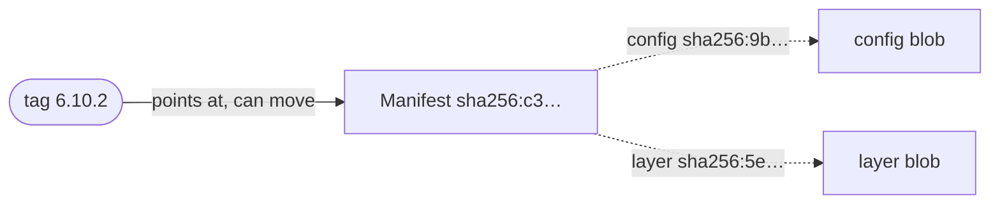
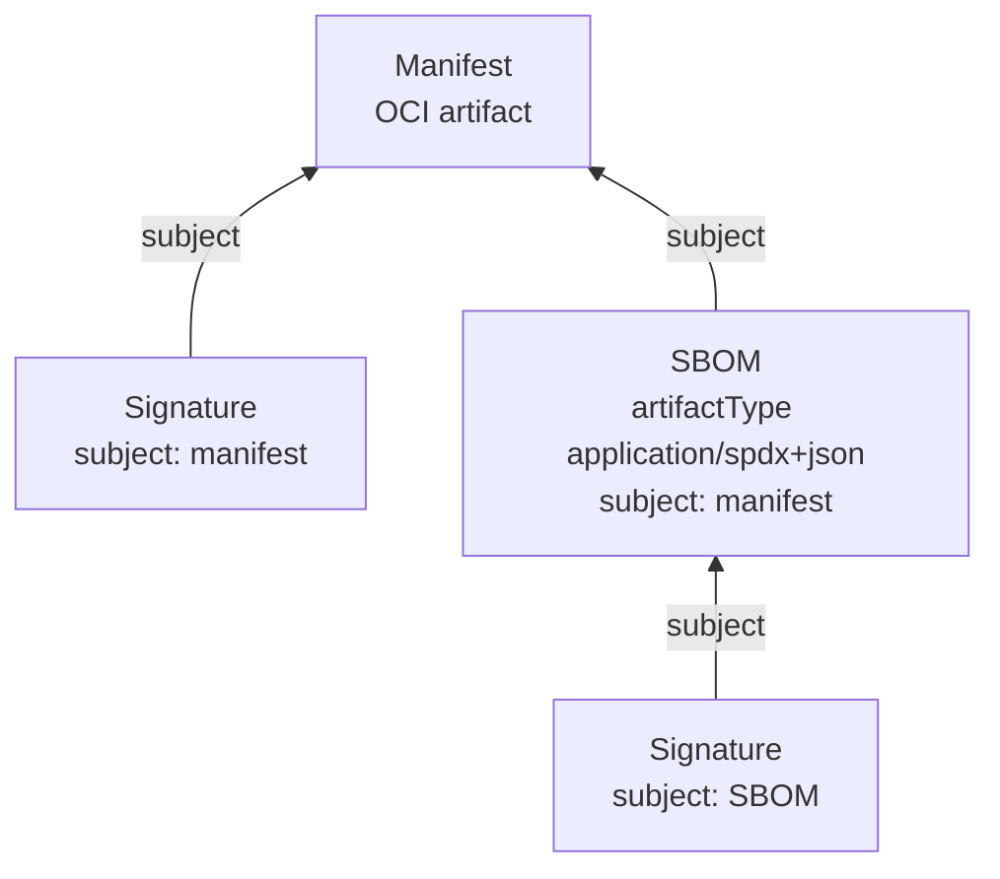

Everything Kokumi delivers is an OCI artifact: the source of a Product, every
Preparation it renders, and the signatures, provenance and approvals that
vouch for them. The UI draws these artifacts as the registry holds them, so a
digest is not just a hash but a box with arrows: what it contains, what
points at it, and who signed it.

| Where | What it shows |
|---|---|
| Preparation → **Artifact** | The rendered artifact, its config (the intent) and layer (the YAML), the images its config records, and the signature, provenance and approvals attached to it. |
| Product → **Artifact** | The source at its source location with what its publisher attached, and the vendored copy. |
| Repository → **Tags** → **Structure** | The artifact behind any tag of the Repository. |

## Four ideas behind every graph

### A manifest names its content by digest

An OCI artifact is a **manifest**: a small JSON document that lists
**blobs** (a config and one or more layers) by their digest, the SHA-256 of
their bytes. The manifest itself is named by its own digest. Change one byte
anywhere and every digest above it changes, so the same digest always means
the same bytes, in any registry it is copied to.



### A tag is a name that can move

A **tag** such as `6.10.2` points at one digest, until someone pushes another
artifact under the same tag. Kokumi therefore never deploys by tag: a Product
resolves its tag to a digest once, Orders render that digest, and Argo CD
pulls the Preparation by its digest. The graph shows where a tag points now;
when it has moved on, the artifact is still there under its digest.

### A referrer points at its subject

Signatures, SBOMs and attestations are artifacts of their own, attached to
another artifact through the OCI 1.1 **referrers** API. Each names the
manifest it is about in its `subject` field, and its `artifactType` says what
it is. A referrer can have referrers too, such as a signature on an SBOM:



Registries without the referrers API store the same relation in an index
under the tag `sha256-<digest>` (the referrers tag schema); the graph looks
the same either way.

Before OCI 1.1, cosign attached signatures by a naming convention instead: a
tag `sha256-<digest>.sig` (or `.att` for attestations, `.sbom` for SBOMs) next
to the artifact. Many upstream releases still carry these. The graph shows
them with a dashed line, because the link is only a name.

### Verified means signed by someone Kokumi trusts

Anyone who can push to a repository can attach a referrer that claims to be
anything, so every signature is verified:

- **A Product's source:** the controller checks every signature in the graph
  against the Product's `spec.source.verify`: its keys or keyless identities.
  Without `verify`, it checks against the keys the Kitchen trusts. The diagram
  shows the verdicts it recorded. See
  [Source Verification](../source-verification/#every-signature-not-only-the-sources).
- **Preparations and Repository tags:** every Sigstore bundle is verified when you
  open the view, against the keys the Kitchen trusts (see
  [Signing](../../operator-guide/signing/)).

Every box carries one status. Only what Kokumi verified is green.

| Status | Meaning |
|---|---|
| **Verified** | A signature by a trusted key or keyless identity. A Sigstore bundle is named after its statement (Signature, SLSA provenance, Approvals). The details show who signed and, for one verified by a Kitchen key, the signed statement. |
| **Signed** | Not a signature itself, such as an SBOM or the artifact, but a verified signature is attached to it. |
| **Unknown signer** | Signed by a key or identity that is not trusted. The signature may well be valid. |
| **Not verified** | A signature that fails verification, for example because it signs another digest. |
| **Not checked** | A signature in a format Kokumi does not verify, such as Notary. Outside a Product's source, also a legacy cosign signature. |
| **Not checked yet** | A signature on a Product's source that was attached after the controller's last check. |
| **Signed · not checked** | Signatures are attached, but none Kokumi could verify. |
| **No signature** | Nothing that claims to sign it is attached. |

Of a signature that is not verified, only the type it claims is shown, never
its content.

## Reading the diagram

| Mark | Meaning |
|---|---|
| Top box | The artifact the view starts from, with its tag, short digest, size, contents (config and layers) and references. |
| Box below | An artifact attached to the one above it, with its kind and status. |
| Solid line with an arrow pointing up | A referrer: it names the manifest above it as its `subject`. |
| Dashed line | Attached by a cosign tag name, not by `subject`. |
| Dotted arrow | A digest inside the manifest: an image index entry, `kokumi.dev/parent`, `org.opencontainers.image.base.digest`, or, on a Preparation, an image its config records. |
| Tag | The tag the artifact was looked up by. It is dashed, and says where it moved, once it points elsewhere. |
| Signer | Who signed the artifact, on the top box: a key icon and the key's name, or, for a keyless signature, the platform's icon and the repository (for example the GitHub workflow that released it). Hover it for the full identity. |

**How to read this** above the diagram repeats these marks. Select a box to
open its details beside the diagram: what it is, how it is attached, who
signed it, its full digest (with a copy button), type, size and creation time,
and, folded away, its blobs, annotations and signed statement. A click
anywhere else, or Escape, closes them. On a Preparation, the config links to
the **Intent** tab, the layer to the **Files** tab, `kokumi.dev/parent` to the
Preparation rendered before it, and the base digest to the Product's source.
Below them, one `image` row per container image the config blob records with a
digest, such as `podinfo:6.14.1@f9537f72…`, links to the **Images** tab; after
six, the card says how many more there are. The config blob is covered by the
Preparation's signature, so these rows show what the signature pins. Under
`Pin` and `Vendor` the manifests pull exactly these digests; under `Record`
they pull the tags, and the rows show what the tags resolved to when the
Preparation was rendered. The images live in repositories of their own and
are not part of the graph.

A view stops after four levels of referrers and 64 artifacts, since anyone who
can push can attach any number of them. It says so when it leaves something
out.

## What Kokumi creates

Every Preparation is one manifest in its Order's destination repository, with
the intent as its config blob and the rendered YAML as its layer. The
Preparation controller attaches a signature and a SLSA provenance; promoting a
Preparation with an approval policy attaches the sealed approvals. The Serving
attaches a record of each promotion and of each healthy deployment (see
[Promotion Pipelines](../promotion-pipelines/#signed-records)). See
[What a Preparation looks like in the registry](../../architecture/#what-a-preparation-looks-like-in-the-registry)
for the annotations and the config blob.

Vendoring copies a Product's source by digest, together with its referrers, to
another repository. Both graphs on the Product's Artifact tab then show the
same digest. Signatures that cosign stored under legacy tags are not
referrers and do not come along; the Product's Artifact tab points out what
the copy is missing.

## The same graph from the command line

The graphs follow the OCI specifications, so standard tools show the same
structure:

```bash
oras discover --format tree <registry>/shop/podinfo-prod@sha256:c3…
cosign tree <registry>/shop/podinfo-prod@sha256:c3…
```
