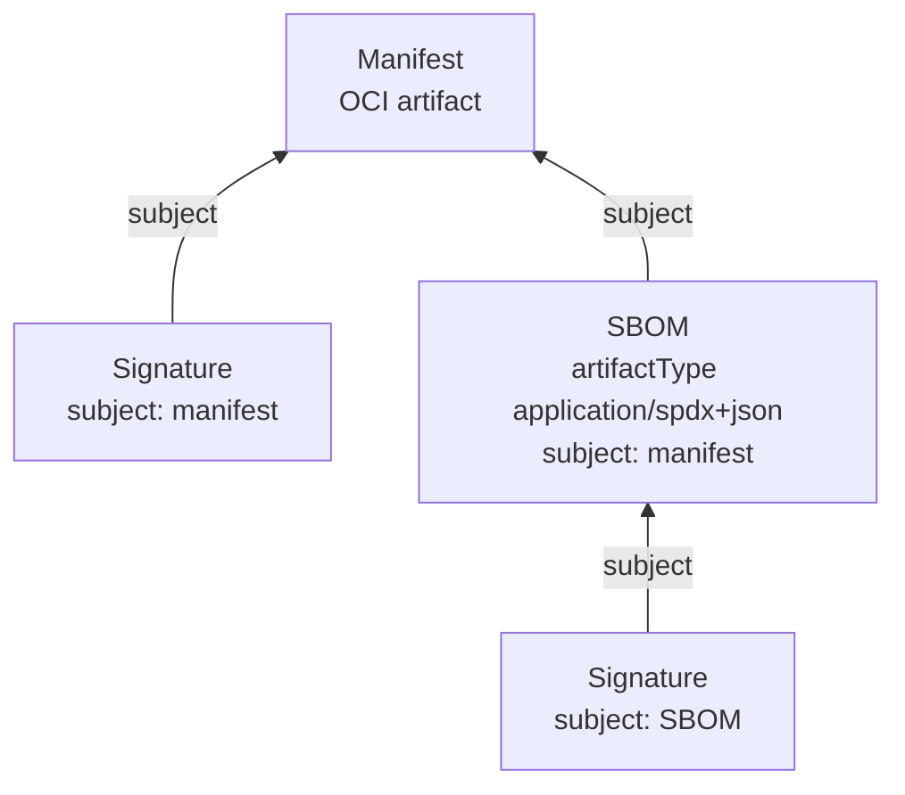

Everything Kokumi delivers is an OCI artifact: the source of a Product, every
Preparation it renders, and the signatures, provenance and approvals that
vouch for them. The UI draws these artifacts as the registry holds them, so a
digest is not just a hash but a box with arrows: what it contains, what
points at it, and who signed it.

| Where | What it shows |
|---|---|
| Preparation → **Artifact** | The rendered artifact, its config (the intent) and layer (the YAML), the images its config records, and the signature, provenance and approvals attached to it. |
| Product → **Artifact** | The source at its source location with what its publisher attached, and the vendored copy. |
| Repository → **Tags** → **Structure** | The artifact behind any tag of the Repository. |

## Four ideas behind every graph

### A manifest names its content by digest

An OCI artifact is a **manifest**: a small JSON document that lists
**blobs** (a config and one or more layers) by their digest, the SHA-256 of
their bytes. The manifest itself is named by its own digest. Change one byte
anywhere and every digest above it changes, so the same digest always means
the same bytes, in any registry it is copied to.


### A tag is a name that can move

A **tag** such as `6.10.2` points at one digest, until someone pushes another
artifact under the same tag. Kokumi therefore never deploys by tag: a Product
resolves its tag to a digest once, Orders render that digest, and Argo CD
pulls the Preparation by its digest. The graph shows where a tag points now;
when it has moved on, the artifact is still there under its digest.

### A referrer points at its subject

Signatures, SBOMs and attestations are artifacts of their own, attached to
another artifact through the OCI 1.1 **referrers** API. Each names the
manifest it is about in its `subject` field, and its `artifactType` says what
it is. A referrer can have referrers too, such as a signature on an SBOM:



Registries without the referrers API store the same relation in an index
under the tag `sha256-<digest>` (the referrers tag schema); the graph looks
the same either way.

Before OCI 1.1, cosign attached signatures by a naming convention instead: a
tag `sha256-<digest>.sig` (or `.att` for attestations, `.sbom` for SBOMs) next
to the artifact. Many upstream releases still carry these. The graph shows
them with a dashed line, because the link is only a name.

### Verified means signed by someone Kokumi trusts

Anyone who can push to a repository can attach a referrer that claims to be
anything, so every signature is verified:

- **A Product's source:** the controller checks every signature in the graph
  against the Product's `spec.source.verify`: its keys or keyless identities.
  Without `verify`, it checks against the keys the Kitchen trusts. The diagram
  shows the verdicts it recorded. See
  [Source Verification](../source-verification/#every-signature-not-only-the-sources).
- **Preparations and Repository tags:** every Sigstore bundle is verified when you
  open the view, against the keys the Kitchen trusts (see
  [Signing](../../operator-guide/signing/)).

Every box carries one status. Only what Kokumi verified is green.

| Status | Meaning |
|---|---|
| **Verified** | A signature by a trusted key or keyless identity. A Sigstore bundle is named after its statement (Signature, SLSA provenance, Approvals). The details show who signed and, for one verified by a Kitchen key, the signed statement. |
| **Signed** | Not a signature itself, such as an SBOM or the artifact, but a verified signature is attached to it. |
| **Unknown signer** | Signed by a key or identity that is not trusted. The signature may well be valid. |
| **Not verified** | A signature that fails verification, for example because it signs another digest. |
| **Not checked** | A signature in a format Kokumi does not verify, such as Notary. Also a legacy cosign signature, except on the source of a Product that sets `spec.source.verify`. |
| **Not checked yet** | A signature on a Product's source that was attached after the controller's last check. |
| **Signed · not checked** | Signatures are attached, but none Kokumi could verify. |
| **No signature** | Nothing that claims to sign it is attached. |

Of a signature that is not verified, only the type it claims is shown, never
its content.

## Reading the diagram

| Mark | Meaning |
|---|---|
| Top box | The artifact the view starts from, with its tag, short digest, size, contents (config and layers) and references. |
| Box below | An artifact attached to the one above it, with its kind and status. |
| Solid line with an arrow pointing up | A referrer: it names the manifest above it as its `subject`. |
| Dashed line | Attached by a cosign tag name, not by `subject`. |
| Dotted arrow | A digest inside the manifest: an image index entry, `kokumi.dev/parent`, `org.opencontainers.image.base.digest`, or, on a Preparation, an image its config records. |
| Tag | The tag the artifact was looked up by. It is dashed, and says where it moved, once it points elsewhere. |
| Signer | Who signed the artifact, on the top box: a key icon and the key's name, or, for a keyless signature, the platform's icon and the repository (for example the GitHub workflow that released it). Hover it for the full identity. |

**How to read this** above the diagram repeats these marks. Select a box to
open its details beside the diagram: what it is, how it is attached, who
signed it, its full digest (with a copy button), type, size and creation time,
and, folded away, its blobs, annotations and signed statement. A click
anywhere else, or Escape, closes them. On a Preparation, the config links to
the **Intent** tab, the layer to the **Files** tab, `kokumi.dev/parent` to the
Preparation rendered before it, and the base digest to the Product's source.
Below them, one `image` row per container image the config blob records with a
digest, such as `podinfo:6.14.1@f9537f72…`, links to the **Images** tab; after
six, the card says how many more there are. The config blob is covered by the
Preparation's signature, so these rows show what the signature pins. Under
`Pin` and `Vendor` the manifests pull exactly these digests; under `Record`
they pull the tags, and the rows show what the tags resolved to when the
Preparation was rendered. The images live in repositories of their own and
are not part of the graph.

A view stops after four levels of referrers and 64 artifacts, since anyone who
can push can attach any number of them. It says so when it leaves something
out.

## What Kokumi creates

A Preparation explains itself from the registry alone: what was asked for,
what it was built from, what built it, and what came before it.

```
kokumi-registry.kokumi.svc.cluster.local:5000/shop/podinfo-prod
│
├─ sha256:c3…  manifest   artifactType: application/vnd.kokumi.preparation.v1
│   ├─ config  application/vnd.kokumi.preparation.config.v1+json     (the intent)
│   ├─ layer   application/vnd.oci.image.layer.v1.tar+gzip           (the rendered YAML)
│   └─ annotations
│        org.opencontainers.image.description: "bump replicas to 3"
│        org.opencontainers.image.created
│        org.opencontainers.image.source / .version / .revision
│        org.opencontainers.image.base.name / .base.digest
│        kokumi.dev/parent: sha256:c1…
│
├─ referrers of sha256:c3…  (Sigstore bundles, application/vnd.dev.sigstore.bundle.v0.3+json)
│   ├─ predicate https://sigstore.dev/cosign/sign/v1              signature
│   ├─ predicate https://slsa.dev/provenance/v1                   SLSA v1 provenance
│   ├─ predicate https://kokumi.dev/attestations/approval/v1      sealed approvals, before promotion
│   ├─ predicate https://kokumi.dev/attestations/promotion/v1     per promotion
│   └─ predicate https://kokumi.dev/attestations/deployment/v1    per healthy deployment
│
└─ tag 6.10.2 → sha256:c3…

kokumi-registry.kokumi.svc.cluster.local:5000/shop/vendor/podinfo/images/ghcr.io/stefanprodan/podinfo
│                                                                          (images.policy: Vendor)
├─ sha256:aa…  image index with its platforms and its upstream referrers
│   └─ referrers: the signed SBOM and vulnerability report, when scanning is enabled
└─ tag 6.10.2 → sha256:aa…
```

- **The manifest** lives in the Order's destination repository, with the
  intent as its config blob and the rendered YAML as its layer.
- **The annotations**: the description is the
  [commit message](../products-and-orders/#describing-a-change); `created`
  equals the config blob's `createdTime`; `source`, `version` and `revision`
  come from the source artifact and link the Preparation back to its commit
  (see [Producing Base Artifacts](../base-artifacts/)); `base.name` and
  `base.digest` name the source artifact; `kokumi.dev/parent` is the
  Preparation rendered before it.
- **The referrers** are Sigstore bundles signed with the
  [Kitchen key](../../operator-guide/signing/), attached through the OCI 1.1
  referrers API: each names the Preparation's manifest in its `subject`.
  Registries without that API store them through the referrers tag schema;
  tools find them either way. The Preparation controller attaches the
  signature and the provenance; the Serving attaches the sealed
  [approvals](../approvals/#sealing) and the
  [promotion and deployment records](../promotion-pipelines/#signed-records).
- **The tag** is the source version. A later Preparation of the same version
  moves it; the digest of this one never changes.
- **The vendored images**, under `images.policy: Vendor`, live in
  repositories of their own below the Product's vendored source, tagged with
  the tag their reference names. They are not part of the Preparation's
  graph: the manifests reference them by digest, and the config blob and the
  provenance list them. The Preparation's signature covers that list, and an
  image is identified by its digest wherever it is copied, so the signed list
  pins every image the Preparation runs. See
  [Container Images](../images/) and
  [Vulnerability Scanning](../security-scanning/).

Vendoring copies a Product's source by digest, together with its referrers, to
another repository. Both graphs on the Product's Artifact tab then show the
same digest. Signatures that cosign stored under legacy tags are not
referrers and do not come along; the Product's Artifact tab points out what
the copy is missing.

## The config blob

The config blob is the authoritative record of a Preparation. The
annotations repeat parts of it so tools can read them without fetching a
blob.

```json
{
  "schemaVersion": 1,
  "order": { "namespace": "shop", "name": "podinfo-prod", "uid": "6f0c…" },
  "configHash": "sha256:9b1d…",
  "commitMessage": "bump replicas to 3",
  "createdTime": "2026-10-12T09:14:03Z",
  "parent": "sha256:c1…",
  "source": {
    "oci": "oci://kokumi-registry.kokumi.svc.cluster.local:5000/shop/vendor/podinfo", "version": "6.10.2", "digest": "sha256:7a…",
    "verified": { "provider": "cosign", "issuer": "https://token.actions.githubusercontent.com", "subject": "https://github.com/…" }
  },
  "destination": { "oci": "oci://kokumi-registry.kokumi.svc.cluster.local:5000/shop/podinfo-prod" },
  "product": { "namespace": "shop", "name": "podinfo", "configHash": "sha256:77e0…" },
  "renderer": { "type": "Helm", "version": "v4.3.0", "builder": "ghcr.io/kokumi-dev/kokumi@sha256:bb…" },
  "intent": {"destination":"oci://kokumi-registry.kokumi.svc.cluster.local:5000/shop/podinfo-prod","productRevision":"sha256:5e1f…","render":{"helm":{"values":{"replicaCount":3,"ui":{"color":"#EF6461"}}}},"source":{"digest":"sha256:7a…","oci":"oci://kokumi-registry.kokumi.svc.cluster.local:5000/shop/vendor/podinfo","version":"6.10.2"},"targetNamespace":"shop"},
  "images": [
    {
      "ref": "ghcr.io/stefanprodan/podinfo:6.10.2", "name": "ghcr.io/stefanprodan/podinfo",
      "digest": "sha256:aa…", "mediaType": "application/vnd.oci.image.index.v1+json",
      "vendored": "kokumi-registry.kokumi.svc.cluster.local:5000/shop/vendor/podinfo/images/ghcr.io/stefanprodan/podinfo:6.10.2@sha256:aa…"
    }
  ]
}
```

- `source.verified` is the signer the Product verified, so the registry
  records who published each rendered input.
- `product.configHash` is the Product's own hash at render time: the hash of
  the source and vendor configuration its source was resolved from, not of
  the intent.
- `images` lists every container image the manifests reference: the
  reference as written, its normalized name, the digest and media type it
  resolved to, the vendored reference under `Vendor`, and the reason for an
  image that could not be resolved. `Preparation.spec.images` repeats the
  list without the reasons.

### The intent and its hash

The `intent` member is the merged configuration that determines the
artifact; [Products and Orders](../products-and-orders/#what-renders-a-new-preparation)
lists what it holds. It is stored as canonical JSON: compact, object keys
sorted at every level, numbers kept as written, and no HTML escaping.
`configHash` is the SHA-256 of exactly these bytes, so equal hashes mean
equal intent, and anyone can recompute the hash from the blob.


Pull access to a destination repository is read access to the intent of
every Preparation in it. And anyone who can push to the repository can push
an artifact that looks like a Preparation: trust the intent and lineage you
read from a registry only once the signature verifies against the Kitchen
key.


### Lineage

Lineage is the render history of one Order in one repository. Every
Preparation names the one rendered before it as its `parent`, in the config
blob and in the `kokumi.dev/parent` annotation. Walking `parent` backwards
gives the history, including Preparations that were never deployed.

- Nothing is ever written to an older artifact. A Preparation carries no
  pointer to later ones, so copying one artifact with its referrers copies
  exactly that revision and its evidence.
- The newest Preparation of an Order is `Order.status.latestArtifactDigest`.
  Without cluster access, it is the version tag whose config blob has the
  newest `createdTime`: every Preparation is pushed under its source version,
  so the newest one is always behind a tag.
- A history ends at a Preparation without a `parent`, or at a `parent` that
  does not exist in the repository. The second case is normal after the
  Order's destination changed.

## Provenance

`spec.renderer` and the config blob record what rendered a Preparation:

| Field | Meaning |
|---|---|
| `type` | `Helm`, or `Manifest` for every other source, a kustomization included |
| `version` | The Helm library version for `Helm`, the Kokumi version for `Manifest` |
| `builder` | The controller that rendered it, normally its image reference with digest |

The controller determines `builder` once at start-up: the
`KOKUMI_BUILDER_ID` environment variable if set, otherwise the image ID of
its own Pod, otherwise `kokumi@<version>`. It is self-reported.

After the push, the Preparation controller signs the artifact and attaches a
[SLSA v1 provenance](https://slsa.dev/spec/v1.0/provenance), both in the
format `cosign` v3 writes: a Sigstore bundle holding a DSSE envelope over an
in-toto statement. It records both in `status.attestations` and sets the
`Signed` and `ProvenanceAttached` conditions.

- The signature is the statement `cosign sign` writes.
- The provenance is built from the config blob. Its `builder.id` is
  `https://kokumi.dev/builders/controller/v1`, and `builder.version` names
  the controller image and the rendering engine. The source is listed by its
  OCI URL, digest and verified signer, followed in `resolvedDependencies` by
  every container image that resolved to a digest, with its media type and,
  under `Vendor`, its vendored reference.
- Signing is deterministic (RFC 6979), so a retried push yields the same
  referrer, and an existing referrer with the same statement is reused.

A Preparation becomes `Ready` only once it is `Signed` and
`ProvenanceAttached`, and only a `Ready` Preparation is promoted. An artifact
whose config blob cannot be read as a Kokumi config is never signed and
never ready. To verify a Preparation and its provenance with cosign, see
[Signing](../../operator-guide/signing/#verify-an-artifact).

## The same graph from the command line

The graphs follow the OCI specifications, so standard tools show the same
structure:

```bash
oras discover --format tree <registry>/shop/podinfo-prod@sha256:c3…
cosign tree <registry>/shop/podinfo-prod@sha256:c3…
```
